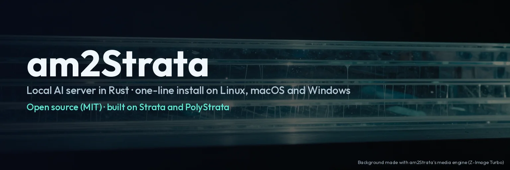
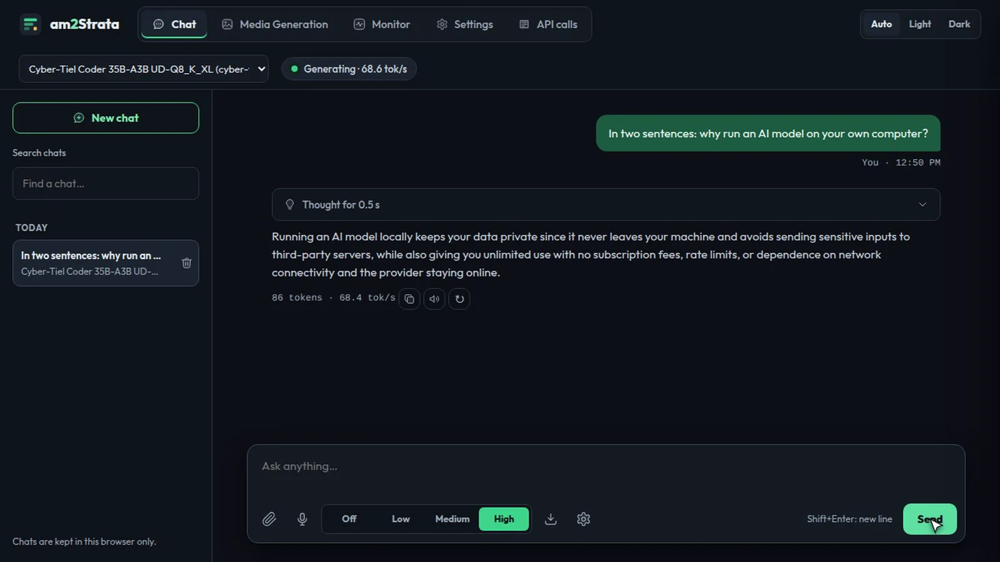
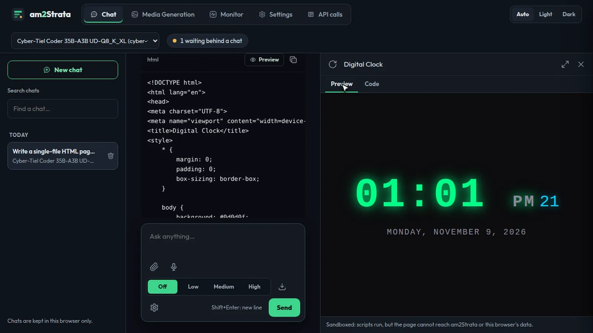
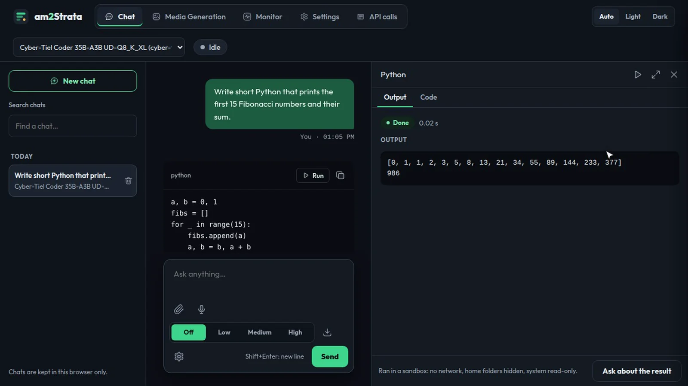
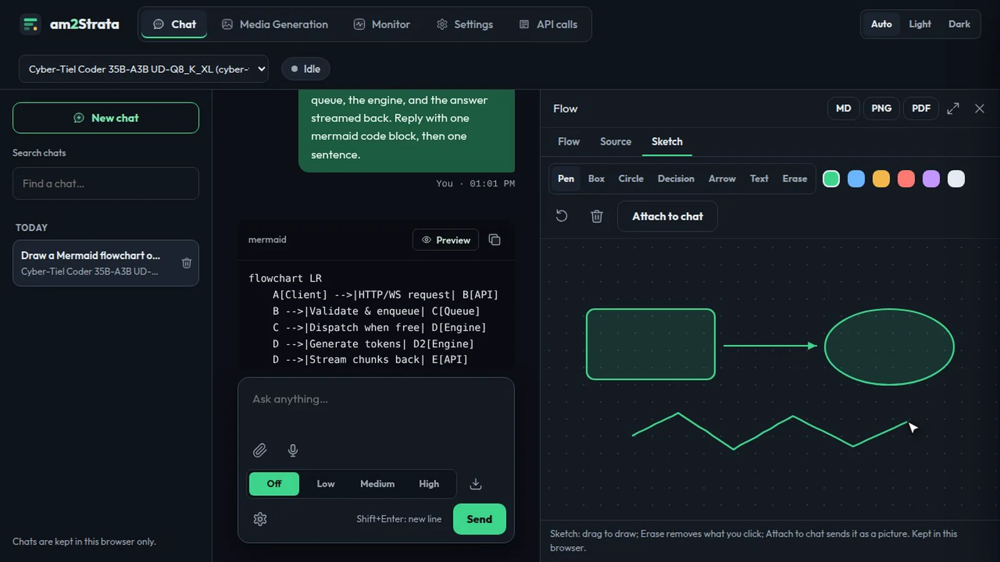
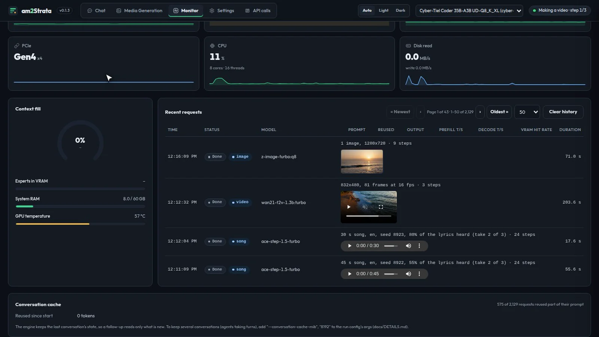
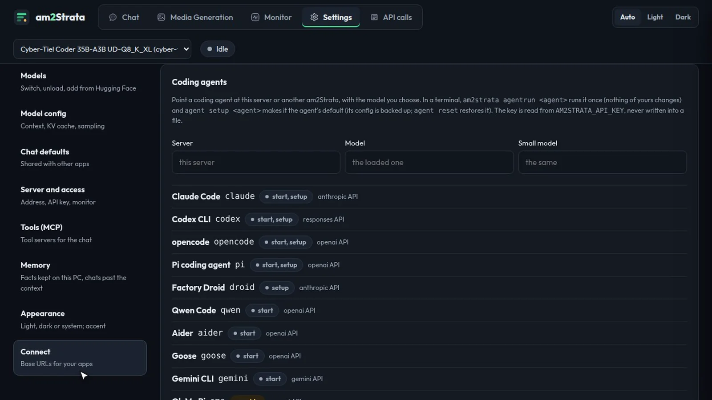

# am2Strata



[](https://github.com/abhaymin/am2strata/releases/latest)
[](LICENSE)
[](https://github.com/sponsors/abhaymin)

Free and open source (MIT). Built on [Strata](https://github.com/Niko1221/Strata) by Niko1221 and the Strata contributors,
and [PolyStrata](https://github.com/VecSzn/PolyStrata) (both MIT).

| Chat | Canvas: an HTML page, live | Python, run in a sandbox |
| --- | --- | --- |
|  |  |  |
| **Flows and the whiteboard** | **Monitor** | **Coding agents** |
|  |  |  |

<sub>Real screenshots of the web app (v0.1.1) on a PC with two RTX 5060 Ti cards, running Tiel Coder 35B-A3B (Q8). The
banner's background was made with am2Strata's media engine (Z-Image Turbo, Apache-2.0).</sub>

am2Strata is a new edition of [PolyStrata](https://github.com/VecSzn/PolyStrata), written in Rust: the server, the
tokenizer, chat templates, output parsing, the Hugging Face downloader, the launcher and every test. PolyStrata's
C++/CUDA engines still do the inference. am2Strata uses PolyStrata's run configs and models as they are, so either
server can run on the same machine (one at a time).

It runs local MoE models (Qwen3.8 / Orca, Tiel Coder, MiniCPM-V, LFM2 and the other architectures PolyStrata's engines
support) behind OpenAI-, Anthropic-, Responses- and Gemini-compatible APIs, with a web app for chat, monitoring and settings.

Plans and where each stands: [docs/LEDGER.md](docs/LEDGER.md).

## Install

**Linux (x86_64) and macOS (Apple Silicon):**

```bash
curl -fsSL https://github.com/abhaymin/am2strata/releases/latest/download/install.sh | sh
```

**Windows (x64), in PowerShell:**

```powershell
irm https://github.com/abhaymin/am2strata/releases/latest/download/install.ps1 | iex
```

Then pull a small model and start the server:

```bash
am2strata pull mistralai/Ministral-3-3B-Instruct-2512-GGUF Q4_K_M
am2strata                      # open http://127.0.0.1:8000
```

The installers check each download's SHA-256 and need no admin rights. You can also take the archive for your system
from [Releases](https://github.com/abhaymin/am2strata/releases); `QUICKSTART.md` inside takes a few minutes. These
downloads run models on the CPU, or on any GPU through wgpu, so they suit small models. The build from source below is
the fast path, for NVIDIA cards.

### Coding agents

```bash
am2strata agentrun opencode                      # or claude, codex, pi, qwen, aider, goose, gemini: one run, nothing changed
am2strata agent setup codex --model <id>         # the agent's default from now on (its config backed up)
am2strata agentrun claude --url http://<other-pc>:8000 --api-key ...   # another am2Strata
```

Claude Code, Codex, opencode, Pi, Factory Droid, Qwen Code, Aider, Goose and the Gemini CLI (through am2Strata's
Gemini API) are set up for you; Oh My Pi, Crush,
Hermes, OpenClaw, Continue, Cline, Kilo Code, Zed and VS Code get the exact block to enter. See
[docs/AGENTS.md](docs/AGENTS.md), or Settings › Connect › Coding agents.

## Build from source (the NVIDIA fast path)

### Requirements

- Linux and an NVIDIA GPU, with PolyStrata's engines built (`strata`, `strata-poly`, `strata-vision`) and its run
  configs (`strata-*.json`). By default am2Strata looks in `~/Development/PolyStrata`, and for models in
  `~/Development/Strata-data`.
- Rust (stable). Optional: `ffmpeg` (video from API clients), `poppler-utils` (PDFs), `bubblewrap` (to run Python
  code from the chat in a sandbox).

### Deploy

Step by step, with ready run configs for Tiel Coder, MiniCPM-V 4.7 and Qwen3.8 Flash Next (Orca):
[docs/DEPLOYMENT.md](docs/DEPLOYMENT.md). In short:

```bash
deploy/build-engines.sh --install                 # PolyStrata's engines, for RTX 30/50 cards
deploy/pull-models.sh tiel                        # or minicpm, orca, all
deploy/install.sh --host 0.0.0.0 --new-key        # configs in place, a new API key; --service to start at boot
target/release/am2strata-run serve --port 8000 --model tiel
```

### Images, video and speech (the media engine)

```bash
cargo build --release --manifest-path crates/strata-media/Cargo.toml --features cuda,onnx
```

- **Speech to text:** Whisper (large-v3 turbo, small, base) on the CPU or the GPU.
- **Text to speech:**
  - **Parler-TTS mini v1:** a voice described in words, on the GPU.
  - **Chatterbox Turbo** (English) and **Chatterbox Multilingual** (Resemble AI, MIT): the voice of a 5 to 10 second
    clip. They run on the CPU, beside the text model, through ONNX Runtime (the `onnx` feature).
    - Multilingual speaks 20 languages here, Hindi, Spanish and French among them. Chinese, Japanese and Hebrew
      come later.
    - Turbo reads tags such as `[laugh]` and `[sigh]`.
    - The engine loads ONNX Runtime 1.23 when it starts: `sudo apt install libonnxruntime1.23` (Debian/Ubuntu), or
      set `ORT_DYLIB_PATH`. Nothing is downloaded at build time.
    - Measured on a Ryzen 7 7840HS (8 threads): about real time (9.2 s of speech in 10.7 s), 5 GB of RAM at
      peak.
- `POST /v1/audio/speech` takes OpenAI's fields. For Chatterbox it also takes:
  - `voice_audio`: a clip, in base64 or as a data URL;
  - `language`, `exaggeration`, `seed`, `temperature`.
- Speech is spoken in the language of the text:
  - `language` is a code (`es`, `hi`, ...) or `auto`; it is `auto` when left out, and the server finds the
    language from the text;
  - a model that speaks only English hands other languages to Chatterbox Multilingual when it is downloaded, unless
    the request names the model (`"switch_for_language": true` allows it anyway);
  - the answer says what was spoken in `x-strata-language` and `x-strata-model`, and what was found in
    `x-strata-language-found`. A language found but spoken by no model here is read as English; one asked for is
    refused, with the download it needs.
  - The web app's Text to speech has a Language picker (Auto by default), and Read aloud in the chat speaks each answer
    in its own language.
- `voice` names one of the built-in voices (laura, jon, lea, gary). Their clips are made once with Parler.
- Clone only a voice whose speaker has agreed to it.

## Packing tools

PolyStrata's model-preparation tools are ported too (crate `strata-pack`), writing the same files byte for byte:

```bash
am2strata-run iq-pack --gguf <model>-00001-of-0000N.gguf --out <pack> --compat-bf16   # tools/iq_pack.py
am2strata-run mtp-fetch fetch --out <mtp>                                             # tools/mtp_fetch.py
am2strata-run mtp-pack --src <mtp> --experts q2_0 --out <mtp>/mtp-q2_0.gguf          # tools/mtp_pack.py
am2strata-run mtp-rt --gguf <mtp>/mtp-q2_0.gguf --out <mtp>/rt                        # tools/mtp_rt.py
```

## Web app

- **Chat:** several chats kept in the browser; pictures, video (frames cut in the browser) and PDFs; a thinking level.
- **Canvas** beside the chat, following what an answer makes:
  - **HTML:** a sandboxed preview with Preview / Code tabs. A Console tab appears when the page has errors, and can
    send them back to the model.
  - **Flows:** a Mermaid diagram opens by itself when an answer has one. Flow / Source / Sketch tabs (a whiteboard);
    exports to Markdown, PNG, PDF, and GIF for animated flows.
  - **Python:** runs on the server in a bubblewrap sandbox (no network, home folders hidden), only when you click Run.
  - **Links:** links in answers open in the canvas, with an address bar.
- **Monitor:** speed, GPU, VRAM, RAM, the context and the requests, live.
- **API calls:** every request's input, output, reasoning and timings.
- **Settings:**
  - models: switch, unload, download from Hugging Face with or without a token;
  - the model's run config, chat defaults, server and access, MCP tools, connect;
  - appearance: light, dark or system theme, and an accent colour.

## What works

`am2strata` runs every model of a PolyStrata folder (each `strata-*.json`) behind one address and switches
between them, driving PolyStrata's own C++/CUDA engines (`strata` for Orca / Qwen3.8, `strata-poly` for Tiel Coder,
MiniCPM-V and the others) over their line protocol.

| Area | State | Checked against |
| --- | --- | --- |
| Tokenizer, chat template, request normalization (OpenAI and Anthropic), quoted special tokens, prompt ids | done | Golden files recorded from PolyStrata's Python: 12 template cases, 16 tokenizer cases and 30 whole requests per model, all identical |
| Output parsing: reasoning, tool calls, streamed tool arguments, quoted `</think>`, calls in code or reasoning | done | 164 recorded parser runs, all identical |
| Tool-call formats GLM, Gemma 4, DeepSeek V4 (DSML), LFM2; gemma4 and deepseek-v3 tokenizers; per-format stop tokens and prompt rules | done | recorded parser runs; synthetic tokenizers recorded from the Python tokenizer (no such model installed here) |
| OpenAI Responses `/v1/responses` (stateless, typed SSE events, namespace and custom tools, encrypted reasoning replay) | done | mock engine; live: Orca |
| Thinking budgets (with answer room), `tool_choice` forcing a call, preserve_thinking, reasoning_close_retry, reasoning_loop_recovery, repeat stop | done | mock engine; live: budget and forced call on Orca |
| MCP tools (stdio and Streamable HTTP servers from the run config, `/mcp`, tool rounds for the web app's `strata_mcp`) | done | mock MCP server |
| Monitor (`/metrics`: request history, totals, live tok/s, GPU/CPU/RAM/disk series), `/metrics/prometheus`, `/v1/status` | done | mock engine; live |
| Hugging Face pull (`am2strata-run pull`: token optional, split shards, mmproj, resumable, SHA-256 checked; tokenizer extracted in Rust; run config written when an engine runs the architecture; new models listed without a restart) | done | live: LFM2-8B-A1B (lfm2moe) pulled, loaded in 9 s, 340 tok/s; extractor byte-identical to PolyStrata's on Tiel and MiniCPM-V |
| Shared chat settings (`/settings`), run-config view (`/config`), config `sampling` block (merged key by key, as PolyStrata) | done | mock engine |
| OpenAI `/v1/chat/completions` (stream and not, tools, images), `/v1/models` | done | live: Orca, Tiel Q6, MiniCPM-V |
| Anthropic `/v1/messages` (stream and not, thinking, tool_use), `/v1/messages/count_tokens` | done | live |
| Images (image encoder process, cache, `GENI`), complex documents | done | live: invoice and purchase order fields exact |
| Video | as frames: video parts are cut into frames with ffmpeg when installed; frames sent as images always work | live (frames); ffmpeg path needs `sudo apt install ffmpeg` |
| Model switching (`/api/models/load`, `/unload`, web picker) | done | live: Orca, MiniCPM-V, Tiel Q6 |
| Web app (am2Strata's `web/`, PolyStrata's app rebranded; MIT notice in `web/LICENSE-PolyStrata.txt`) | done: chat, model picker, settings, monitor polling | live in a browser |
| Stop strings, model-card default sampling, `fit_max_tokens` | done | live |
| Hardware adaptation | GPU detection; refuses an engine not compiled for the card (with the fix); image encoder on the CPU below 15.5 GB of VRAM; encoder started before the engine so its VRAM is set aside | live on the RTX 5060 Ti |

Live numbers on the RTX 5060 Ti 16 GB (warm, greedy, thinking off): Tiel Coder Q6 104-106 tok/s median through
this server (PolyStrata: ~98, same expert placement: 3,713 experts in VRAM); Orca's engine came up with the same
expert cache as under PolyStrata (3,985 slots, 8.27 GB).

GPU builds: the PolyStrata engines on the developer's PC are compiled for sm_86 and sm_120 (RTX 30 and RTX 50
cards). Only the RTX 5060 Ti has been tested; an RTX 3060 should run the same build, but it has not been tried.
am2Strata refuses an engine that is not compiled for the card, and says how to rebuild it.

## Tested on

Everything above, the demo videos included, was built, tested and recorded on one PC. That PC also runs
am2Strata day to day, as a user service that starts at boot.

| Part | What it is |
| --- | --- |
| CPU | AMD Ryzen 7 7840HS (8 cores, 16 threads), with Radeon 780M graphics (not used) and an XDNA NPU (not used yet) |
| RAM | 64 GB (about 60 GB visible to Linux; the integrated graphics keep the rest) |
| GPUs | 2 × NVIDIA GeForce RTX 5060 Ti 16 GB (Blackwell, sm_120): one on OCuLink, one in a USB4 dock |
| Storage | 2 TB NVMe SSD (WD Blue SN580) |
| OS | Ubuntu 26.04.1 LTS, Linux 7.0 |
| NVIDIA | driver 595.99.02 (CUDA 13.2), CUDA toolkit 13.1 |
| Rust | 1.93.1 |
| ONNX Runtime (for Chatterbox) | 1.23.2, Ubuntu's `libonnxruntime1.23` |

How it runs there:
- **Server:** `am2strata --host 0.0.0.0 --port 8000 --models-dir <the PolyStrata folder> --api-monitor`, behind an
  API key, so other machines on the network can use it.
- **Default model:** Cyber-Tiel Coder 35B-A3B UD-Q8_K_XL through PolyStrata's `strata-poly` engine, its layers split
  across both cards.
- **Media engine:** built with `--features cuda,onnx`.

Measured there, in normal use:

| What | Result |
| --- | --- |
| Tiel Coder Q8, split across both cards, in the web app | about 68 tokens/s |
| Tiel Coder Q6 on one card | 104-106 tokens/s (median, warm, greedy, thinking off) |
| An image with Z-Image Turbo, 1024×1024, one card | about 80 s |
| An image with Qwen-Image | 186 s, its stages split across both cards (peak 8.7 GB on one, 10.7 GB on the other); on one card it ran out of memory |
| Speech with Chatterbox Turbo (ONNX), on the CPU beside the loaded text model | about real time (9.2 s of speech in 10.7 s, 8 threads); 5 GB of RAM at the peak, while loading |
| Speech to text with Whisper large-v3-turbo, on the CPU | 5 GB of RAM at the peak |

Not tested yet on real hardware: macOS and Windows (the downloads are built for them, and the tests run there in
CI), AMD and Intel GPUs, RTX 30 cards, and PCs with a single card under 16 GB. Reports from other machines are
welcome in the [issues](https://github.com/abhaymin/am2strata/issues).

## Not yet

- **Media in the downloads:** image, video and voice generation come only with a build from source
  (`crates/strata-media`); the release downloads do not hold the media engine (its audio and video codecs have
  their own terms, see NOTICE). Images and video need an NVIDIA card (the `cuda` feature); speech to text and text
  to speech also run on the CPU, slowly for speech out. Tested on Linux only.
- **Parallel slots and replicas:** PolyStrata's opt-in batch slots and replicas are not ported. am2Strata runs one
  request at a time on a model, and the others wait in its queue.

## Use

```sh
cargo run -q --release --bin am2strata-run -- test                          # the whole test suite (no GPU)
cargo run -q --release --bin am2strata-run -- serve --take-over --port 8000 # foreground, in place of PolyStrata's service
cargo run -q --release --bin am2strata-run -- temp-service --port 8000      # temporary user service; PolyStrata's returns when it stops
cargo run -q --release --bin am2strata-run -- stop-temp-service
cargo run -q --release --bin am2strata-run -- install --port 8000           # boot service in place of strata-orca (same configs, models)
cargo run -q --release --bin am2strata-run -- uninstall                     # strata-orca back as the boot service
cargo run -q --release --bin am2strata-run -- pull LiquidAI/LFM2-8B-A1B-GGUF               # list its quantizations
cargo run -q --release --bin am2strata-run -- pull LiquidAI/LFM2-8B-A1B-GGUF --quant Q4_K_M  # download + run config
# live GPU tests against a running server
STRATA_LIVE_URL=http://127.0.0.1:8000 STRATA_LIVE_KEY=... cargo test -p am2strata --release --test live -- --ignored --test-threads=1
```

Golden files are recorded from PolyStrata with:

```sh
~/Development/PolyStrata/.venv/bin/python tools/reference-polystrata/make_golden.py
```

The engine protocol is written down in [docs/PROTOCOL.md](docs/PROTOCOL.md).

## Support

am2Strata is free and open source. If it is useful to you, you can support its development through
[GitHub Sponsors](https://github.com/sponsors/abhaymin). Thank you.

## License

MIT, see [LICENSE](LICENSE) and [NOTICE](NOTICE). Parts are derived from PolyStrata (MIT, Niko1221 and the Strata contributors).
