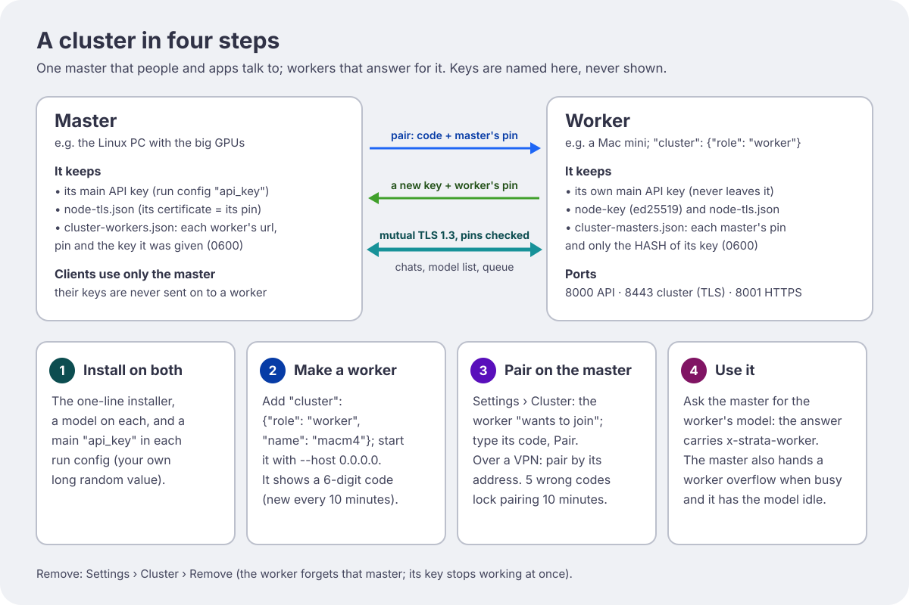
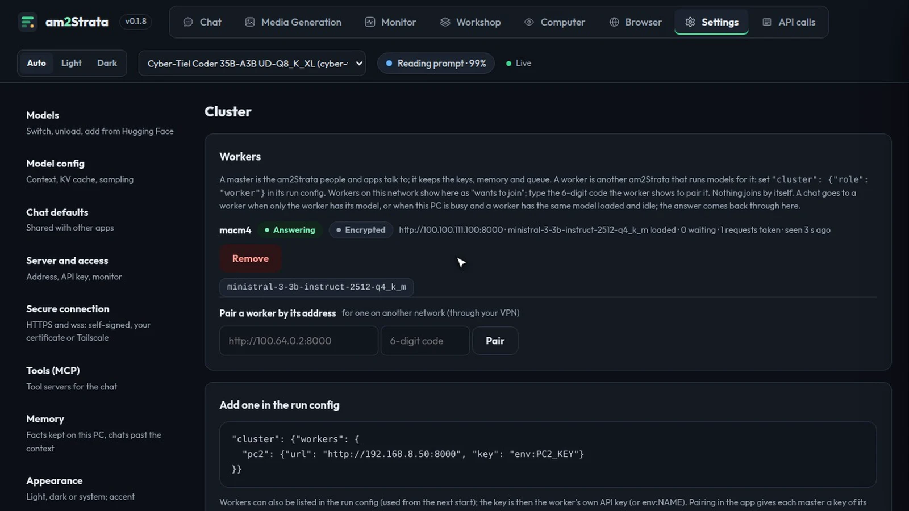

# Set up a cluster

Several machines working as one am2Strata. People and apps talk to one machine, the **master**. Other machines,
**workers**, answer for it. This page gives the exact steps, every key involved and where it is kept, and what a
cluster does and does not do today. The design and the work still to come are in [CLUSTER-PLAN.md](CLUSTER-PLAN.md).





## What a cluster does today

- **Routing whole requests.** A chat goes to a worker in two cases:
  - its model is on the worker and not on the master;
  - the master is busy and a worker has the same model loaded and idle.

  The answer, streamed too, comes back through the master. It carries `x-strata-worker: <name>`, and the call is
  kept in the master's records.
- **Not yet: one model split across machines.** Each request runs on one machine, with a model that fits that
  machine. Splitting a model's layers across machines is planned (CLUSTER-PLAN, phase 2). It is not built.
- **A worker that is down is skipped.** A worker that has not answered for 15 s gets no new work. The master shows
  why in Settings › Cluster.

## What you need

| | Master | Each worker |
|---|---|---|
| am2Strata | installed, with a model | installed, with a model |
| Network | reaches the worker's API port (default 8000) and its cluster port (default API + 443 = 8443) | listens beyond itself: `--host 0.0.0.0` |
| A VPN between them | optional on your own LAN; **recommended** otherwise (Tailscale, WireGuard) | same |
| A main API key | yes, your own long random value | yes, its own; it never leaves the worker |

### The keys and secrets, and where each one lives

None of these is ever shown on this page, in a screenshot or in a video. You make the two main keys yourself; the
rest are made by am2Strata and stay on the machine that made them.

| What | Where | Made by | Who sees it |
|---|---|---|---|
| Master's main API key | the master's run config, `"api_key"` | you (a long random value, e.g. `openssl rand -hex 32`) | you and the apps you give it to; never sent to a worker |
| Worker's main API key | the worker's run config, `"api_key"` | you | only you, on the worker |
| Node identity (ed25519) | `<data>/node-key`, file mode 0600 | am2Strata, on first start | nobody: it never leaves the machine |
| Node certificate | `<data>/node-tls.json`, 0600 | am2Strata, on first start | its SHA-256 (the **pin**) is swapped when pairing |
| Pairing code (6 digits) | the worker's log and its Settings › Cluster | the worker; new every 10 minutes and after each use | you type it into the master once |
| The master's key on the worker | the master's `<data>/cluster-workers.json` (0600); the worker keeps only its **SHA-256** in `cluster-masters.json` (0600) | the worker, when the right code arrives; answered once | only the master |
| HTTPS certificate (optional) | `<data>/server-tls/` | `am2strata-run tls self-signed` or `tls tailscale` | browsers and apps that use the worker's own HTTPS |

`<data>` is the data folder: `~/.local/share/am2strata` from the installer.

## Step by step

### 1. Install on both machines

```bash
curl -fsSL https://github.com/abhaymin/am2strata/releases/latest/download/install.sh | sh -s -- --service
am2strata pull mistralai/Ministral-3-3B-Instruct-2512-GGUF Q4_K_M   # or a model that suits the machine
```

On Windows, use `install.ps1` (see the README). `--service` starts the server when you sign in: a systemd user
service on Linux, a launchd agent on macOS.

### 2. Give each machine a main API key

In each machine's run config (the `strata-<model>.json` the installer made; `am2strata doctor` shows where), set
`"api_key"` to a long random value of your own:

```json
"api_key": "<a long random value: never paste it into chats, issues or screenshots>"
```

A server that listens beyond itself without a key would answer anyone who reaches it.

### 3. Make the worker

In the worker's run config:

```json
"cluster": {"role": "worker", "name": "macm4"}
```

Start it so the network can reach it: `--host 0.0.0.0 --port 8000`. With `--service`, put these in the service's
arguments (the systemd unit, or the launchd plist under `~/Library/LaunchAgents`), then restart the service.

The worker now:
- makes its node identity and certificate on first start;
- announces itself on the LAN (mDNS, `_am2strata._tcp`);
- opens its cluster port, the API port + 443 (`"tls_port"` changes it). Only a master paired with it gets in there;
- shows a **6-digit pairing code** in its log and in its own Settings › Cluster. The code changes every 10 minutes.

### 4. Pair on the master

**In the web app:**
1. Open the master's Settings › Cluster.
2. A worker on the same LAN shows as "wants to join"; type its code and press **Pair**.
3. For a worker over a VPN, pair it by its address instead (for example its Tailscale address), with the same code.

**From a shell on the master** (its main key, sent from this machine):

```bash
curl -s http://127.0.0.1:8000/api/cluster/pair \
  -H "Authorization: Bearer $AM2STRATA_API_KEY" -H "Origin: http://127.0.0.1:8000" \
  -H 'Content-Type: application/json' \
  -d '{"url": "http://<worker address>:8000", "code": "<the 6-digit code>"}'
# {"paired":"macm4","url":"http://…:8000","node_id":"…","encrypted":true}
```

What happens:
1. The master sends the code and its own pin.
2. The worker checks the code in constant time. Five wrong codes lock pairing for 10 minutes.
3. The worker makes a key for this master alone and keeps only that key's hash. It answers with the key, once, and
   with its own pin.
4. From then on the master reaches the worker **only over mutual TLS 1.3**, on the cluster port. Each side checks the
   other's certificate against the pin it was given. There is no certificate authority: the pin is the trust.

### 5. Check it

```bash
curl -s http://127.0.0.1:8000/api/cluster -H "Authorization: Bearer $AM2STRATA_API_KEY" -H "Origin: http://127.0.0.1:8000"
```

Each worker shows:
- `"transport": "TLS 1.3, pinned certificates"`;
- `"ready": true`;
- its models and the loaded one;
- an `"error"` when it cannot be reached, with the reason.

Then ask the master for the worker's model:

```bash
curl -s -D - http://127.0.0.1:8000/v1/chat/completions -H "Authorization: Bearer $AM2STRATA_API_KEY" \
  -H 'Content-Type: application/json' \
  -d '{"model": "<the worker'"'"'s model id>", "messages": [{"role": "user", "content": "Say hello."}]}' | grep -i x-strata-worker
# x-strata-worker: macm4
```

### 6. Optional: HTTPS on the worker's own API

Traffic between the master and the worker is already encrypted (step 4). To encrypt the worker's own API for
browsers and apps that use it directly:

```bash
am2strata-run tls tailscale --http local-only     # a trusted certificate for <machine>.<tailnet>.ts.net
am2strata-run tls self-signed --http local-only   # or self-signed: compare its SHA-256 the first time
```

`--http local-only` keeps plain HTTP for that machine itself and redirects everyone else to HTTPS.

**Before you choose:**
- **Tailscale certificates are public.** A Tailscale certificate puts the machine's tailnet name in public
  Certificate Transparency logs, and that cannot be undone.
- **Older versions lose the master.** In releases up to v0.1.8, `local-only` or `redirect` on a worker also redirected
  the master's requests on the cluster port, and the master then lost the worker ("the worker's certificate is not
  the one paired"). Fixed in [#55](https://github.com/abhaymin/am2strata/pull/55). On an older worker, keep `"http":
  "keep"` or update it first.

### Remove a worker

On the master, open Settings › Cluster and press **Remove**, or send `DELETE /api/cluster/workers/<name>`. The master
tells the worker to forget it, and the key it was given stops working at once. To pair again, use a new code.

## Ports

| Port | On | What |
|---|---|---|
| 8000 | every machine | the API and the web app (plain HTTP; `local-only` once HTTPS is on) |
| 8443 | workers | the cluster port: mutual TLS 1.3, paired masters only (API port + 443, or `"tls_port"`) |
| 8001 | any machine with HTTPS on | its own HTTPS and wss (`"https_port"`) |

## Workers listed in the run config instead

A master can also list workers in its run config, with the worker's own key:

```json
"cluster": {"workers": {"pc2": {"url": "http://192.168.8.50:8000", "key": "env:PC2_KEY"}}}
```

`env:PC2_KEY` reads the key from that environment variable, so it isn't written in the file.

Prefer pairing:
- **It's plain HTTP.** Workers listed this way are reached over plain HTTP with the key, so use them only inside a
  VPN.
- **The worker's main key leaves it.** That key has to be given to the master.

## Speed: what to expect

Measured on 2026-11-15:

| Machine | Model | Prompt reading | Writing |
|---|---|---|---|
| Linux PC, 2× RTX 5060 Ti | Tiel Coder 35B-A3B Q8 | ~360 tokens/s on new text, more with a reused prefix | 64-90 tokens/s |
| Mac mini M4, 16 GB, CPU | Ministral 3B Q4_K_M | 4.7 tokens/s | 3.8 tokens/s |

**What this means for coding agents:**
- **Prompts are long.** A coding agent's prompts run 15 000-80 000 tokens, so a worker is only useful for that
  work when it reads prompts quickly.
- **This Mac on its CPU is too slow.** It needs about 2.5 minutes for a 750-token chat. It suits short chats with a
  small model.
- **Not yet tried:** the Mac's GPU, through wgpu.
- **No speed-up for one request.** Until a model can be split across machines, a cluster adds machines for more
  requests at once. It doesn't make one request faster.
